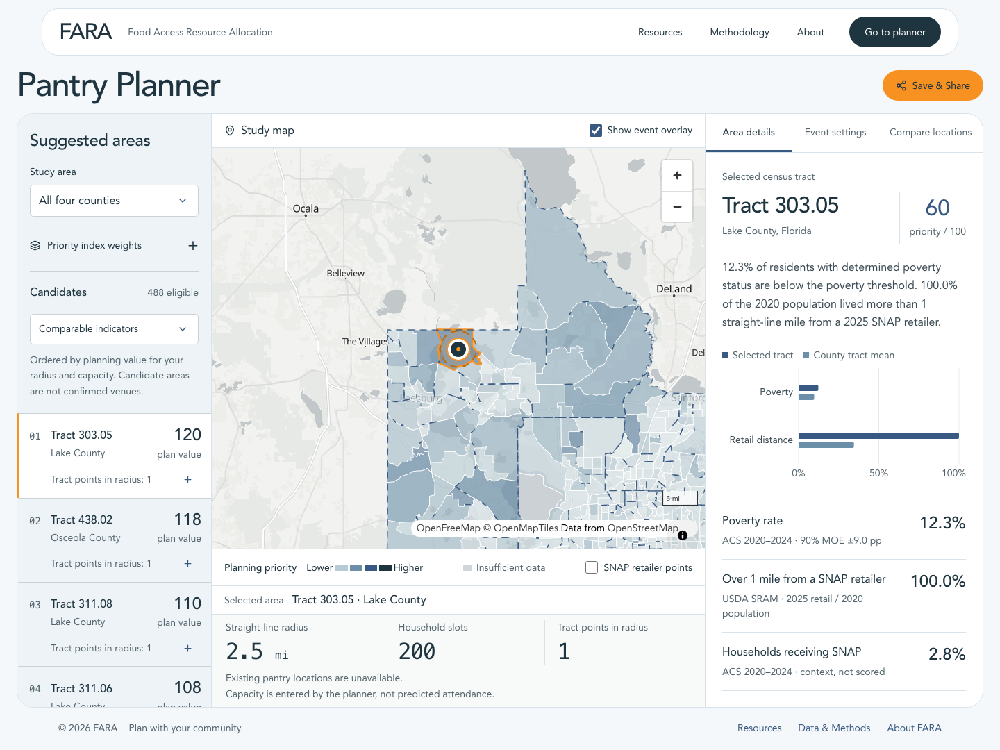

# FARA

FARA (Food Access Resource Allocation) is a planning workspace for food banks and community organizations within central Florida deciding where to hold a mobile pantry event. It brings public food-access data, a map, and practical event decisions into one place—so a promising area can become a plan worth discussing.

The map helps you decide **where to look**. Local knowledge helps you decide **what will work**.

[See the planner](#the-planner) · [Run it locally](#run-locally) · [Understand the data](#where-it-works) · [Deploy](#deployment)



## The planner

FARA follows the questions a planner actually has to answer:

| Explore                                                                                                     | Make a plan                                                                                                                      | Get feedback                                                                                                                               |
| ----------------------------------------------------------------------------------------------------------- | -------------------------------------------------------------------------------------------------------------------------------- | ------------------------------------------------------------------------------------------------------------------------------------------ |
| Which areas deserve a closer look? Compare census tracts using poverty and distance-to-retailer indicators. | What might an event look like? Set a location, radius, capacity, time, and budget; compare alternatives and flag local concerns. | Does the proposal work for the community? Share a read-only plan, collect an anonymous check-in, and review aggregate responses privately. |

You can adjust the priority weights and test different assumptions. Recommendations recalculate from the same published data; there's no generative AI or opaque prediction behind the ranking.

FARA also includes a **Resources** directory with food-program guidance, referral tools, and organizations serving Central Florida. Resources, Data & Methods, and About use plain title-only page headings and show all explanations without expandable sections. On screens wider than 700px, the Resources and Data & Methods contents lists highlight the current topic while scrolling and support ordinary keyboard-accessible section links. Phones show the content directly, with no table of contents and a centered footer across all three reference pages.

## Where it works

The current study area covers **Lake, Orange, Osceola, and Seminole counties** in Florida.

- **490** Census tracts in the dataset; **488** have enough data to be scored.
- **1,694** SNAP retailer points in the supplied snapshot.
- Sources include Census boundaries, American Community Survey indicators, and USDA retail-access data.

These numbers describe the current processed dataset, not a live count of people needing assistance.

> **An important distinction:** A high-priority tract is not a confirmed pantry site. FARA does not know where existing pantries operate, whether a venue is available, how long a trip takes, or how many people will attend. Every proposal needs a local check before anyone acts on it.

Read the [methodology](docs/methodology.md) and [known limitations](docs/limitations.md) for the scoring rules and what the map cannot tell you.

## Run locally

You'll need **Node.js 24 LTS** and npm. macOS, Linux, or Windows with WSL2 are recommended.

The five processed map files are intentionally **not stored in Git**. Put an authorized set of these files in `public/data/` before starting:

```text
public/data/
  manifest.json
  areas.json
  tracts.geojson
  counties.geojson
  retailers.geojson
```

Then:

```bash
git clone https://github.com/coreymichaud/fara.git
cd fara
npm ci
cp .env.example .env.local
npm run data:validate
npm run dev
```

Open [http://localhost:3000](http://localhost:3000) and choose **Go to planner**.

The example environment uses a local JSON store for saved plans. That's for development only; production uses Firestore.

### Building the data files yourself

If you have the original source data, place it in `data/raw/` using the filenames listed in the [data audit](docs/data_audit.md). The processing pipeline needs **Python 3.12–3.13** and [uv](https://docs.astral.sh/uv/).

```bash
cd analysis
uv sync --locked
uv run python src/pipeline.py
cd ..
npm run data:validate
```

The pipeline creates the minimized web assets and checks the joins, geometries, and source data. Raw inputs, intermediate files, credentials, and restricted reference materials stay out of Git and the production image. See the [publication notes](docs/LICENSING.md) before redistributing data.

## Sharing a plan

The planner provides separate links for each audience:

- A **public, read-only plan** with the full proposal, planning estimates, assumptions, and alternatives.
- A **community survey** with just the proposed location, time, and existing four anonymous questions.
- A **private creator link** for managing the proposal and seeing aggregated responses.

Use **Save & Share** at the top right of the planner to save the proposal and open its sharing popup. **Your Saved Plan** is the primary, full-width section: keep that public link to revisit the saved proposal, or share it with partners. **Community Survey** and **Your Private Dashboard** sit underneath it, with open actions, copy confirmations, and selectable URLs. All three open actions launch a new tab so the planner stays open. Every newly saved plan includes a survey link; using or sharing that link is optional. Creators can still close or reopen the check-in from their dashboard.

The popup keeps the private-link reminder visible and supports keyboard navigation. Close it with the X, Escape, or a click or tap outside; focus returns to Save & Share. Clicking its content or dragging from inside keeps it open. Reopening it keeps the same links without saving a duplicate plan. Editing the proposal makes the next Save & Share create a new saved snapshot. The planner stays at its full size behind the popup, with no bottom save bar or verification disclosure.

The public plan lives at `/plans/{id}`, the participant survey at `/plans/{id}/survey`, and the private dashboard at `/plans/{id}/manage`. The organizer's detailed plan has no survey prompt or check-in section. Share the separate survey link with participants: it opens a standalone form with a small FARA label and no website navigation or footer, and retains an optional link to the full proposal. Closing or reopening the check-in through the creator dashboard controls the survey page and submissions through the existing API.

Save the private dashboard link to review results and open or close the community check-in later. Anyone with it can access the dashboard, so do not share it publicly. The creator token continues to be stored in this browser when storage is available; the private link also works in another browser. Small response groups are suppressed in results, and the survey does not ask for names or contact details. It's feedback on a proposal—not a representative survey or an event registration system.

## Deployment

FARA runs as a Next.js application on **Cloud Run**, with **Firestore** for saved plans and survey responses. A manual **Cloud Build** trigger pulls the source from GitHub, fetches the five approved data assets from a private Cloud Storage bucket, validates them, builds the container, and publishes the image to Artifact Registry before deployment.

The full walkthrough—including the two service accounts, IAM roles, bucket layout, and post-deploy checks—is in **[Deployment](docs/DEPLOYMENT.md)**. Cloud Run access is configured separately: a new service is private until an administrator chooses to make the website public.

## Development and tests

The app uses Next.js, TypeScript, React, MapLibre, and Firestore. The data pipeline lives in `analysis/`; the planning calculations live in `src/lib/domain/`.

The planner's shared proposal state and save flow live in `src/features/planner/workspace.tsx`. Its area explorer, map, evidence, event settings, and location comparison are separate components in the same directory. The sharing popup and link sections live in `share-plan-dialog.tsx` and `saved-plan-links.tsx` in that directory. The homepage SVG lives in `src/features/home/study-atlas.tsx`. Styles are grouped by feature in `src/app/styles/`, imported through `globals.css` with shared breakpoint overrides last. Browser tests are organized into home, reference, planner, and sharing journeys in `e2e/`.

For the fast checks:

```bash
npm run lint
npm run typecheck
npm test
```

The complete `npm run check` suite also exercises data validation, Python checks, browser journeys, and Firestore integration. It needs the processed data and a running Firestore Emulator. See [Verification](docs/VERIFICATION.md) for the test setup and recorded results.

## Further reading

| Document                                                                 | What's there                                      |
| ------------------------------------------------------------------------ | ------------------------------------------------- |
| [Data & Methods](docs/methodology.md)                                    | How the priority score and candidate ranking work |
| [Data audit](docs/data_audit.md) · [Dictionary](docs/data_dictionary.md) | Sources, fields, and processing notes             |
| [Limitations](docs/limitations.md)                                       | What the results should—and shouldn't—be used for |
| [Deployment guide](docs/DEPLOYMENT.md)                                   | Cloud setup, permissions, and release steps       |
| [Verification](docs/VERIFICATION.md)                                     | Tests, coverage, and known gaps                   |

---

FARA is an independent project, not an official DataKind product or Beacon integration. Statistical source credit: **U.S. Census Bureau and USDA ERS**.

Released under the [MIT License](LICENSE).
